<p align="center">
  
</p>

<h1 align="center">Tallkeer</h1>

<p align="center">
  Ditado por voz em qualquer aplicativo do Windows, com formatação por inteligência artificial.<br />
  Segure um atalho, fale, solte: o texto aparece onde está o cursor, pontuado e no tom certo.
</p>

<p align="center">
  
  
  
  
  
</p>

<p align="center">
  Trabalho da disciplina <b>Engenharia de Software</b> · Fatec São Carlos · 2026<br />
  Autor: <b>Gabriel Varandas Rodrigues de Souza</b> (<a href="https://github.com/varanderzz">@varanderzz</a>)
</p>

---

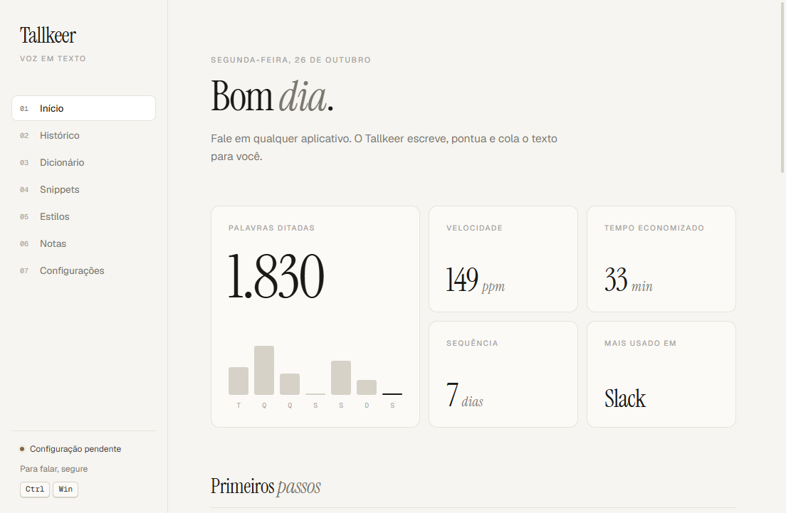

## Sumário

1. [Sobre o Projeto](#1-sobre-o-projeto)
2. [Tecnologias, Ferramentas e Infraestrutura](#2-tecnologias-ferramentas-e-infraestrutura)
3. [Metodologias Utilizadas](#3-metodologias-utilizadas)
4. [Projeto de Interface](#4-projeto-de-interface)
5. [Documentação completa](#5-documentação-completa)
6. [Como executar](#6-como-executar)

---

## 1. Sobre o Projeto

O **Tallkeer** é um aplicativo de **ditado por voz para Windows**. O usuário segura **Ctrl + Win**, fala e solta. O aplicativo transcreve a fala, formata o texto com inteligência artificial e o insere onde estiver o cursor, em qualquer programa: WhatsApp, Word, Outlook, navegador, editores de código.

O projeto é **inspirado no Wispr Flow**, um aplicativo comercial de ditado por voz, e foi escrito com **código inteiramente próprio**. Ao contrário do app de inspiração, que processa tudo nos próprios servidores, o Tallkeer guarda os dados **só no computador do usuário** e deixa ele escolher o serviço de transcrição, inclusive um que funciona **offline**.

### Principais funcionalidades

| Funcionalidade | O que faz |
| --- | --- |
| **Ditado em qualquer app** | Segure **Ctrl + Win**, fale e solte. O texto aparece no cursor. |
| **Mãos livres** | Um toque rápido no atalho grava sem precisar segurar. |
| **Modo Comando** | Selecione um texto, segure **Ctrl + Win + Alt** e diga "deixa mais formal" ou "traduz para inglês". |
| **Formatação com IA** | Pontuação, remoção de hesitações ("hum", "né"), autocorreções ("às 3, na verdade às 4" vira "às 4") e listas. |
| **Estilos por aplicativo** | Formal no e-mail, casual no Slack, descontraído no WhatsApp. |
| **Dicionário e snippets** | Grafia correta de nomes e termos; frases faladas que viram textos prontos. |
| **Histórico, estatísticas e notas** | Busca nos ditados, palavras por minuto, tempo economizado, gráfico da semana. |
| **Privacidade** | Dados só no computador; chaves de API criptografadas pelo Windows. |

### Público-alvo

Pessoas que escrevem muito no computador (estudantes, profissionais de escritório, programadores) e querem escrever mais rápido falando, sem trocar de programa.

---

## 2. Tecnologias, Ferramentas e Infraestrutura

### Desenvolvimento

| Camada | Tecnologia | Por que foi escolhida |
| --- | --- | --- |
| **Plataforma** | Electron 44 (Chromium + Node.js 24) | Aplicativo desktop com interface em HTML/CSS/JS e acesso ao sistema operacional, numa única linguagem. |
| **Linguagens** | JavaScript, HTML5, CSS3 | A mesma linguagem na interface e no sistema, sem etapa de compilação. |
| **Atalhos globais** | `uiohook-napi` | Detecta quando a tecla é pressionada **e solta**, o que o atalho nativo do Electron não faz. |
| **API do Windows** | `koffi` | Descobre o app em primeiro plano em menos de 1 ms, sem compilar código nativo. |
| **Microfone** | Web Audio API / AudioWorklet | Captura o áudio em PCM 16 kHz, o formato ideal para o Whisper. |
| **Empacotamento** | electron-builder (instalador NSIS) | Gera o instalador `.exe` padrão do ecossistema Electron. |
| **Testes** | `node:test` + teste de fumaça no Electron | Testes nativos do Node, sem dependências extras; o teste de fumaça abre o app real com microfone simulado. |

### Infraestrutura e serviços

O Tallkeer **não tem servidor próprio**. Ele roda inteiro no computador do usuário e só se conecta aos serviços abaixo, com a chave de API do próprio usuário:

| Serviço | Uso | Tipo |
| --- | --- | --- |
| **Groq** (Whisper Large v3 Turbo) | Transcrição padrão, rápida e com plano gratuito | Nuvem |
| **OpenAI** (gpt-4o-mini-transcribe) | Transcrição alternativa | Nuvem |
| **whisper.cpp** | Transcrição sem internet | Local |
| **Anthropic** (Claude) | Formatação do texto e Modo Comando | Nuvem |
| **Arquivos JSON** em `%APPDATA%\Tallkeer` | Configurações, histórico, dicionário, snippets e notas | Local |
| **DPAPI do Windows** (`safeStorage`) | Criptografia das chaves de API | Local |
| **GitHub Releases** | Distribuição do instalador `.exe` | Nuvem |

### Ferramentas de apoio

| Ferramenta | Uso |
| --- | --- |
| **Git + GitHub** | Controle de versão, histórico de mudanças e distribuição (ver [3.2](#32-como-o-git-e-o-github-são-usados)) |
| **VS Code** | Editor de código |
| **Claude Code** | Assistente de programação com IA, usado para escrever código, testes e documentação sob direção e revisão do autor |
| **npm** | Dependências e scripts (`start`, `test`, `dist`) |

### Arquitetura resumida

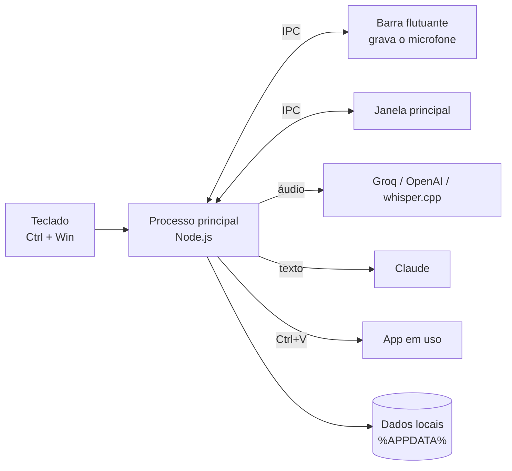

Detalhes em [docs/ARQUITETURA.md](docs/ARQUITETURA.md).

---

## 3. Metodologias Utilizadas

### 3.1 Modelo de processo: **Incremental**

O Tallkeer foi desenvolvido no **modelo incremental**: o software é dividido em partes, e cada **incremento** entrega uma versão que funciona e pode ser usada, somando funcionalidades à anterior.

#### Por que o Incremental?

Dois fatos do projeto pesaram na escolha:

1. **Os requisitos principais eram conhecidos desde o início.** Como o projeto é inspirado em um app que já existe, a lista do que o Tallkeer deveria fazer estava clara. Isso dispensa a análise de risco formal a cada volta que o modelo Espiral exige.
2. **O app precisava ser usado para ser avaliado.** Só usando o ditado no dia a dia dava para saber se a formatação ficava boa, se o atalho atrapalhava outros programas e se a interface era confortável. O incremental coloca uma versão usável nas mãos do usuário cedo e melhora a partir do uso.

O primeiro incremento atacou de propósito o maior risco técnico: **conseguir capturar um atalho global e colar texto em qualquer programa do Windows**. Se isso não funcionasse, nenhuma outra funcionalidade faria sentido.

#### Os incrementos

| Incremento | Versão | O que foi entregue | Por que nessa ordem |
| :---: | :---: | --- | --- |
| **1** | interno | **Núcleo do ditado:** atalho → gravação → transcrição → formatação → colagem | É o maior risco técnico e o valor central do app. |
| **2** | `v0.1.0` (20/10) | **Funcionalidades de apoio:** dicionário, snippets, estilos, histórico, estatísticas, notas, configurações, testes e instalador | Só fazem sentido depois que o ditado funciona. |
| **3** | `v0.2.0` (21/10) | **Evolução:** nome Tallkeer, interface redesenhada, tema claro/escuro | Veio do uso real da v0.1.0: a interface funcionava, mas não era agradável. |
| **4** | `v0.2.1` (26/10) | **Manutenção corretiva:** colagem consertada após mudança de API do Electron 44 | Um problema que só apareceu com o app em uso. |

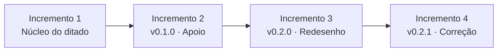

**Exemplo concreto:** na v0.2.1, a colagem parou de funcionar com o erro `clipboard.availableFormats is not a function`, porque o Electron 44 trocou a API da área de transferência por uma versão assíncrona. Como cada incremento é uma versão completa e testada, foi possível corrigir **só o módulo de colagem** (`inserter.js`), rodar os testes e lançar uma nova versão, sem mexer no resto do app.

#### Alternativas consideradas

| Modelo | Por que foi descartado |
| --- | --- |
| **Cascata** | O app só ficaria usável no fim. O redesenho da v0.2.0 surgiu justamente do uso da v0.1.0; na cascata, essa descoberta viria tarde demais, na fase mais cara de mudar. |
| **Espiral** | Exige análise formal de riscos a cada volta. Para um projeto individual e curto, com requisitos já conhecidos, esse custo seria maior que o benefício. O único risco grande (atalho global + colagem) foi resolvido no primeiro incremento. |
| **Scrum** | Tem papéis (Product Owner, Scrum Master, time) e cerimônias pensados para equipes. Com uma pessoa só, viraria burocracia. |

#### Limites da escolha

- **Retrabalho de interface:** como a interface foi feita antes de ser testada no uso, a v0.2.0 precisou redesenhá-la por completo.
- **Dependência de testes:** cada incremento pode quebrar o anterior, então o modelo depende de testes automatizados. O bug da v0.2.1 escapou justamente porque o teste **simulava** a área de transferência em vez de usar a real; depois disso, o teste de fumaça passou a cobrir esse trecho.
- **O que me faria mudar de ideia:** se o Tallkeer passasse a ter uma equipe, eu adotaria **Scrum**; se passasse a ter servidores e contas de usuário, com riscos de segurança e custo maiores, o **Espiral** passaria a valer a pena.

### 3.2 Como o Git e o GitHub são usados

O código, a documentação e o histórico ficam neste repositório público. As versões anteriores à criação do repositório estão registradas no [histórico de versões](docs/CHANGELOG.md); a partir da `v0.2.1`, todo o desenvolvimento passa pelo fluxo abaixo.

**Ramos (*branches*)**

| Ramo | Para que serve |
| --- | --- |
| `main` | Sempre igual à última versão lançada. Não recebe commits diretos. |
| `feature/<nome>` | Uma funcionalidade nova por ramo, por exemplo `feature/transcricao-streaming`. |
| `fix/<nome>` | Correção de um problema, por exemplo `fix/colagem-electron-44`. |

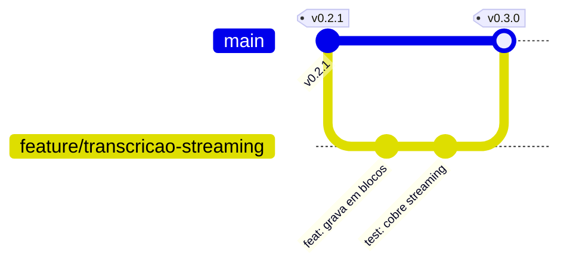

**Boas práticas adotadas**

- **Commits pequenos e com mensagem clara**, no padrão *Conventional Commits*: `feat: adiciona modo mãos livres`, `fix: corrige colagem no Electron 44`, `docs: atualiza manual`.
- **Pull request para juntar na `main`**, mesmo trabalhando sozinho. O PR mostra a mudança completa e só entra depois de `npm test` passar.
- **Tags com versionamento semântico** (`vMAIOR.MENOR.CORREÇÃO`): correção sobe o último número (`v0.2.1`), funcionalidade nova sobe o do meio (`v0.3.0`).
- **Releases no GitHub** com o instalador `.exe` anexado, para que ninguém precise compilar o projeto para usar.
- **Issues** para registrar bugs e ideias (por exemplo, os [trabalhos futuros](docs/RELATORIO.md#14-limitações-e-trabalhos-futuros)).
- **Nada de arquivo gerado ou segredo no repositório:** o `.gitignore` exclui `node_modules/`, `dist/` e `build/`, e as chaves de API ficam criptografadas em `%APPDATA%`, fora da pasta do projeto.

---

## 4. Projeto de Interface

A interface segue uma linha **minimalista editorial**: paleta monocromática quente, títulos em fonte serifada com uma palavra em itálico e cor usada só para indicar estado (verde-sálvia = pronto, terracota = gravando ou erro). Todas as telas existem nos temas **claro** e **escuro**.

### Telas da janela principal

| Início | Histórico |
| :---: | :---: |
|  | 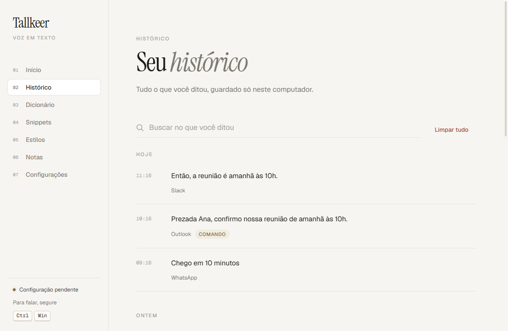 |
| Estatísticas, gráfico da semana e primeiros passos. | Todos os ditados por dia, com busca, cópia e o texto original. |

| Dicionário | Snippets |
| :---: | :---: |
| 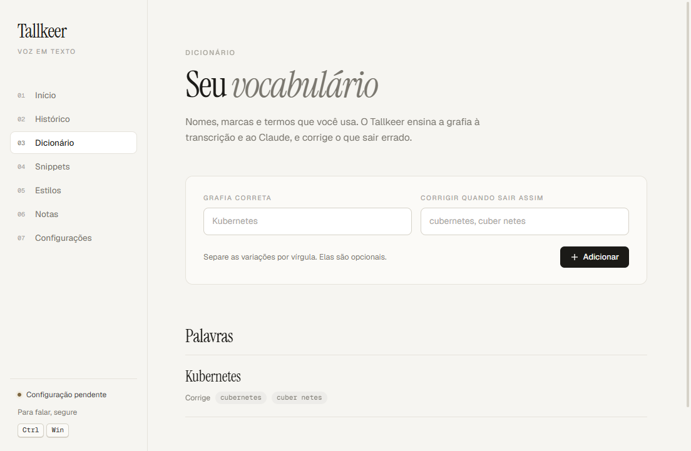 | 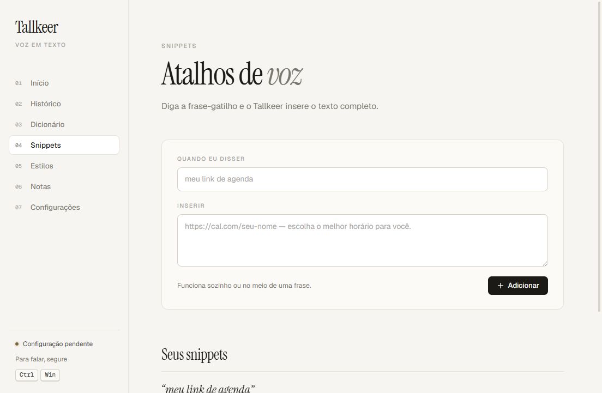 |
| Grafia correta de nomes e termos, e as variações a corrigir. | Frase-gatilho falada → texto pronto. |

| Estilos | Notas |
| :---: | :---: |
| 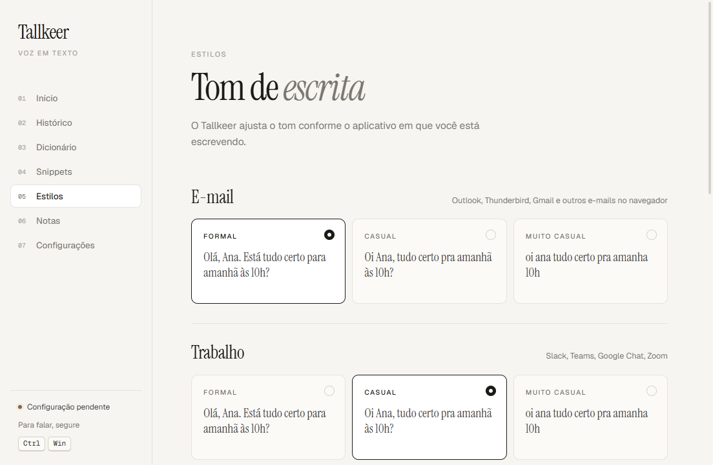 | 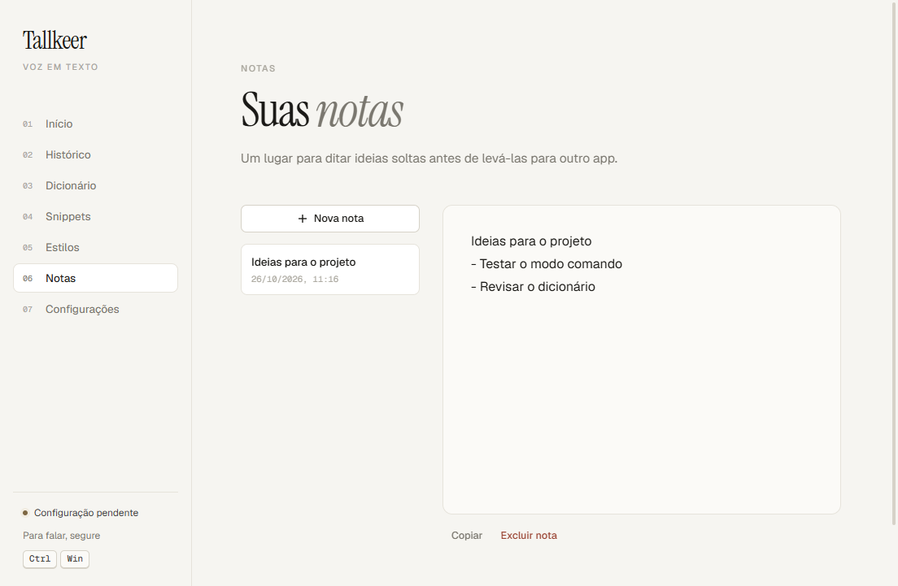 |
| Tom de escrita por tipo de aplicativo. | Rascunhos salvos automaticamente. |

| Configurações | Tema escuro |
| :---: | :---: |
| 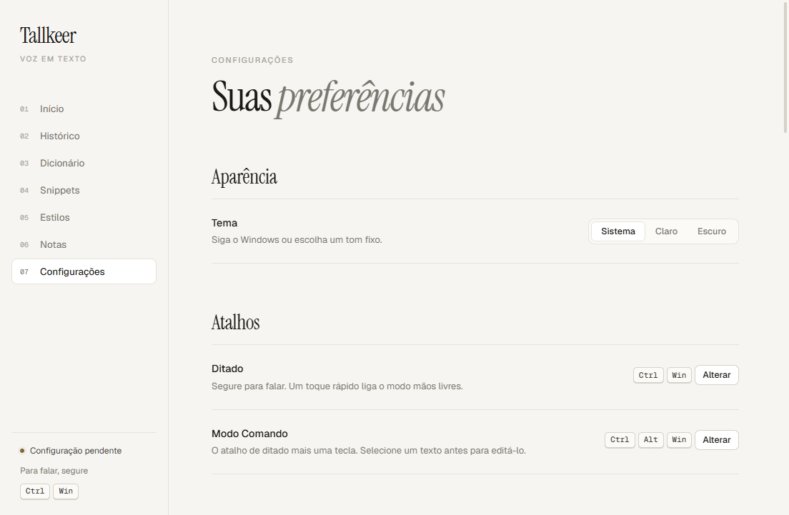 | 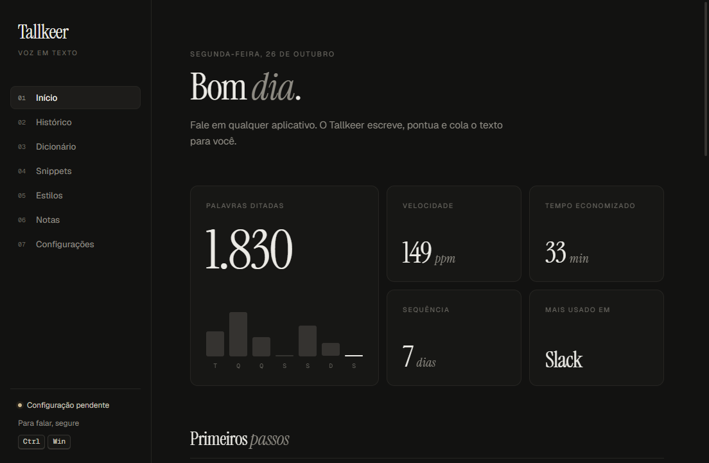 |
| Tema, atalhos, microfone, idioma, provedores e chaves. | A mesma interface no tema escuro. |

### Barra flutuante

Aparece na parte de baixo da tela durante o ditado e **não rouba o foco** do programa em uso.

| Gravando | Transcrevendo | Inserido | Erro |
| :---: | :---: | :---: | :---: |
| 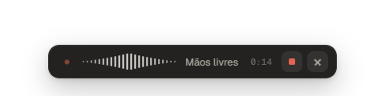 |  |  |  |

### Fluxo de um ditado

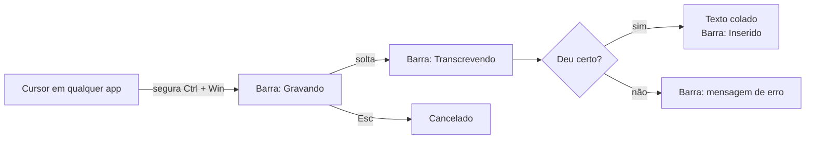

As telas de todas as seções nos dois temas estão em [`docs/screenshots/`](docs/screenshots/).

---

## 5. Documentação completa

| Documento | Conteúdo |
| --- | --- |
| 📘 [Relatório técnico](docs/RELATORIO.md) | Objetivo, requisitos, tecnologias, testes, segurança, problemas encontrados e conclusão |
| 🏗️ [Arquitetura](docs/ARQUITETURA.md) | Diagramas, módulos, fluxo do ditado, máquina de estados, IPC, persistência |
| ✨ [Funcionalidades](docs/FUNCIONALIDADES.md) | Cada funcionalidade explicada, com capturas de tela |
| 📖 [Manual do usuário](docs/MANUAL.md) | Instalação, configuração, uso e solução de problemas |
| 📝 [Histórico de versões](docs/CHANGELOG.md) | O que mudou em cada versão |

---

## 6. Como executar

Requisitos: Windows 10 ou 11, [Node.js](https://nodejs.org) 22 ou mais novo.

```bash
git clone https://github.com/varanderzz/tallkeer.git
cd tallkeer
npm install
npm start
```

Na primeira execução, a tela **Início** mostra os primeiros passos. Cole uma chave da [Groq](https://console.groq.com/keys) (gratuita) em **Configurações** e, se quiser a formatação por IA, uma chave da [Anthropic](https://console.anthropic.com/settings/keys).

> Mantenha o projeto numa pasta de caminho curto: o Electron não abre se o caminho dos arquivos passar de 260 caracteres.

| Comando | O que faz |
| --- | --- |
| `npm start` | Abre o app em modo de desenvolvimento |
| `npm test` | Roda os 37 testes automatizados |
| `npm run dist` | Gera o instalador em `dist/` |
| `npx electron . --smoke=<pasta>` | Teste de fumaça: abre o app com dados de exemplo, fotografa as telas e faz um ditado com microfone simulado |

```
tallkeer/
├── src/
│   ├── main/        processo principal: atalhos, ditado, transcrição, IA, dados
│   ├── preload/     pontes seguras entre janelas e processo principal
│   └── renderer/    interfaces (janela principal, barra flutuante, fontes)
├── test/            testes automatizados
├── scripts/         geração do ícone
└── docs/            relatório, arquitetura, funcionalidades, manual, capturas
```

---

<p align="center">
  Desenvolvido por <b>Gabriel Varandas Rodrigues de Souza</b> · Engenharia de Software · Fatec São Carlos · 2026<br />
  <sub>Código sob a licença <a href="LICENSE">MIT</a>. Fontes embutidas sob a SIL Open Font License (ver <code>src/renderer/fonts</code>).<br />
  Tallkeer não tem relação com o Wispr Flow nem com a empresa que o desenvolve.</sub>
</p>
