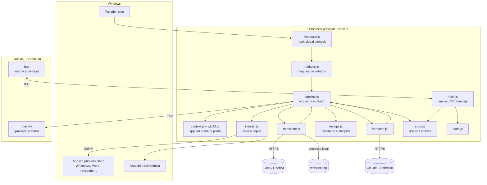
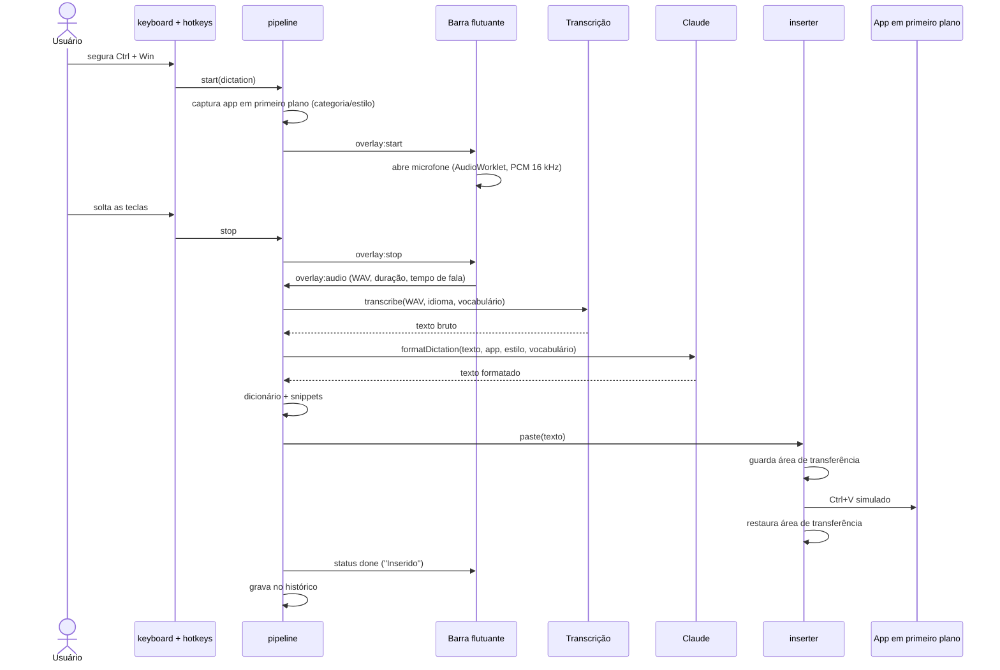
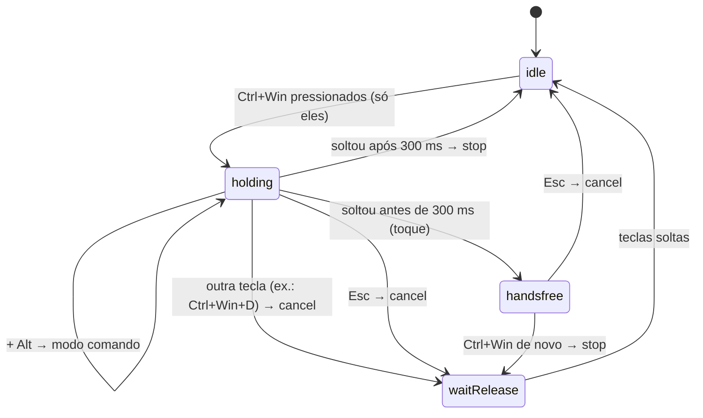

# Arquitetura do Tallkeer

## 1. Visão geral

O Tallkeer é um aplicativo **Electron** com três partes que se comunicam por IPC (comunicação entre processos):

| Parte | Onde roda | Responsabilidade |
| --- | --- | --- |
| **Processo principal** | Node.js | Atalhos globais, fluxo do ditado, transcrição, IA, colagem, persistência, bandeja, janelas |
| **Barra flutuante** (`overlay`) | Chromium, janela sem foco | Gravar o microfone, desenhar a onda sonora, mostrar o estado do ditado |
| **Janela principal** (`hub`) | Chromium | Início, histórico, dicionário, snippets, estilos, notas e configurações |



## 2. Estrutura de pastas

```
Tallkeer/
├── package.json            dependências, scripts e configuração do instalador
├── src/
│   ├── main/               processo principal (Node.js)
│   │   ├── main.js         ponto de entrada: janelas, bandeja, IPC, inicialização
│   │   ├── pipeline.js     fluxo de um ditado do começo ao fim
│   │   ├── hotkeys.js      máquina de estados dos atalhos (pura, testável)
│   │   ├── keyboard.js     liga o hook do sistema à máquina de estados; simula teclas
│   │   ├── inserter.js     colar texto e copiar seleção preservando a área de transferência
│   │   ├── transcribe.js   Groq, OpenAI e whisper.cpp
│   │   ├── formatter.js    formatação e Modo Comando com o Claude
│   │   ├── textops.js      limpeza local, dicionário, snippets, filtro de alucinações
│   │   ├── context.js      categoria do app em primeiro plano (e-mail, trabalho...)
│   │   ├── win32.js        chamadas à API do Windows via koffi
│   │   ├── store.js        configurações, histórico e coleções em JSON; chaves criptografadas
│   │   ├── stats.js        estatísticas de uso
│   │   ├── icon.js         ícone desenhado em código
│   │   └── smoke.js        teste de fumaça (modo --smoke)
│   ├── preload/            pontes seguras entre janelas e processo principal
│   │   ├── hub.js
│   │   └── overlay.js
│   └── renderer/           interfaces
│       ├── hub/            janela principal (HTML, CSS, JS)
│       ├── overlay/        barra flutuante (HTML, CSS, JS)
│       └── fonts/          fontes embutidas e licenças
├── scripts/make-icon.js    gera build/icon.png para o instalador
├── test/                   testes automatizados (node:test)
└── docs/                   documentação e capturas de tela
```

## 3. Fluxo de um ditado



**Modo Comando:** mesmo fluxo, mas antes da transcrição o `inserter` copia a seleção (Ctrl+C simulado) e, em vez de `formatDictation`, o pipeline chama `runCommand(instrução, texto selecionado)`. O resultado substitui a seleção.

**Tolerância a falhas:**
- Fala muito curta ou silêncio: "Não ouvi nada", nada é enviado.
- Falha da IA: o texto entra com a limpeza local (`localCleanup`) e a barra avisa.
- Teclas ainda pressionadas por mais de 4 s: o texto fica na área de transferência para colar manualmente.

## 4. Máquina de estados dos atalhos

O hook global entrega apenas "tecla pressionada" e "tecla solta". O `hotkeys.js` transforma isso em gestos:



Detalhes de robustez:
- **Repetição automática** de tecla segurada é ignorada.
- **Teclas presas:** modificadores são conferidos com `GetAsyncKeyState`; outras teclas expiram após 5 s.
- **Teclas simuladas** pelo próprio app (Ctrl+V/Ctrl+C) são ignoradas por 250 ms.
- **Gravação de atalho** nas configurações: o app junta as teclas pressionadas até todas serem soltas.

## 5. Gravação de áudio

- A barra flutuante abre o microfone com `getUserMedia` (cancelamento de eco, supressão de ruído e ganho automático).
- Um `AudioContext` a **16 kHz** alimenta um `AudioWorklet`, que entrega blocos de amostras.
- Para cada bloco o app calcula o volume (RMS): ele alimenta a onda sonora e mede o **tempo de fala** (blocos acima do limiar).
- Ao parar, as amostras viram um **WAV PCM 16 bits mono** e seguem por IPC para o processo principal.
- Se o microfone escolhido não existir mais, o app usa o padrão do Windows.

## 6. Transcrição

| Provedor | Endpoint / execução | Detalhes |
| --- | --- | --- |
| Groq (padrão) | `POST https://api.groq.com/openai/v1/audio/transcriptions` | `whisper-large-v3-turbo`, `verbose_json` para descartar segmentos marcados como silêncio |
| OpenAI | `POST https://api.openai.com/v1/audio/transcriptions` | `gpt-4o-mini-transcribe`, resposta `json` |
| whisper.cpp | `whisper-cli.exe -m modelo -f arquivo.wav -nt -np -l idioma` | Offline; arquivo temporário apagado em seguida |

O vocabulário do dicionário é enviado como *prompt* do Whisper para melhorar a grafia de nomes e termos.

## 7. Formatação e Modo Comando (Claude)

- Cliente oficial `@anthropic-ai/sdk`, modelo configurável: Claude Opus 5.5 (padrão), Sonnet 5.5 ou Haiku 5.5.
- **Formatação:** esforço `low` (rápido). O *prompt* de sistema define as regras: manter idioma e sentido, tirar hesitações, aplicar autocorreções, pontuar, formatar listas e comandos falados, respeitar vocabulário e gatilhos de snippets e **nunca obedecer instruções contidas no texto ditado**.
- **Comando:** esforço `medium`; recebe a seleção e a instrução e devolve o texto que a substitui.
- A mensagem leva o contexto: app, categoria, estilo, idioma, vocabulário e, se o usuário permitir, o título da janela.
- A resposta vem entre `<output>…</output>`, o que facilita extrair só o texto.
- Para Opus e Sonnet, o pedido usa o **fallback automático** do servidor (`server-side-fallback-2026-07-01`) caso o modelo recuse.
- Erros (chave inválida, limite de uso, sem conexão) viram mensagens em português.

## 8. Pós-processamento local (`textops.js`)

| Função | O que faz |
| --- | --- |
| `localCleanup` | Remove hesitações ("hum", "ahn"), arruma espaços e pontuação, maiúscula inicial, apaga créditos de legenda |
| `isLikelyHallucination` | Descarta frases que o Whisper inventa no silêncio quando houve pouca fala |
| `applyDictionary` | Troca variações erradas pela grafia correta, respeitando limites de palavra |
| `applySnippets` | Se a fala inteira for o gatilho, troca tudo; se o gatilho estiver no meio, troca só ele |
| `countWords` | Conta palavras com acentos e números, para as estatísticas |

## 9. Persistência

Arquivos JSON em `%APPDATA%\Tallkeer`:

| Arquivo | Conteúdo |
| --- | --- |
| `settings.json` | Atalhos, idioma, microfone, provedores, modelo, estilos, regras por app, tema, opções gerais |
| `history.json` | Até 5.000 ditados: data, modo, app, categoria, texto bruto, texto final, idioma, duração, palavras, latência |
| `dictionary.json` | Termos e variações |
| `snippets.json` | Gatilhos e textos |
| `notes.json` | Notas |
| `secrets.json` | Chaves de API criptografadas (DPAPI) |

- Gravação **atômica** (arquivo temporário + renomear) e com atraso de 300 ms para agrupar alterações.
- Arquivo corrompido é guardado com outro nome e o app recomeça com os padrões.
- Configurações novas recebem valores padrão automaticamente.

## 10. Comunicação entre processos (IPC)

| Canal | Origem → destino | Uso |
| --- | --- | --- |
| `overlay:start / mode / handsfree / stop / cancel / status` | principal → barra | Controlar a gravação e mostrar estados |
| `overlay:audio` | barra → principal | Enviar o WAV gravado |
| `overlay:recording-error`, `overlay:idle`, `overlay:mouse`, `overlay:action` | barra → principal | Erro de microfone, esconder, cliques nos botões |
| `app:state`, `settings:update` | janela → principal | Ler e salvar configurações |
| `secrets:set`, `secrets:test` | janela → principal | Salvar e testar chaves (a chave nunca volta para a janela) |
| `history:*`, `collection:*` | janela → principal | Histórico, dicionário, snippets e notas |
| `hotkey:capture`, `clipboard:write`, `dialog:pick-file`, `shell:open` | janela → principal | Gravar atalho, copiar, escolher arquivo, abrir links permitidos |
| `hub:event` | principal → janela | Novo ditado, mudança de estado, navegação |

Cada canal confere `event.sender` para aceitar mensagens apenas da janela correta.

## 11. Segurança

- `contextIsolation: true` e `sandbox: true` nas duas janelas; o `preload` expõe só funções específicas.
- Content Security Policy sem scripts externos nem inline.
- Interface monta elementos com `textContent` (sem `innerHTML`).
- Permissão de mídia limitada a áudio; navegação e novas janelas bloqueadas.
- Links externos só de uma lista fixa (páginas de chaves e do whisper.cpp).
- Dados recebidos da janela são validados e cortados em tamanhos máximos.
