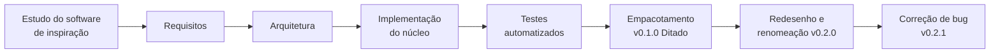
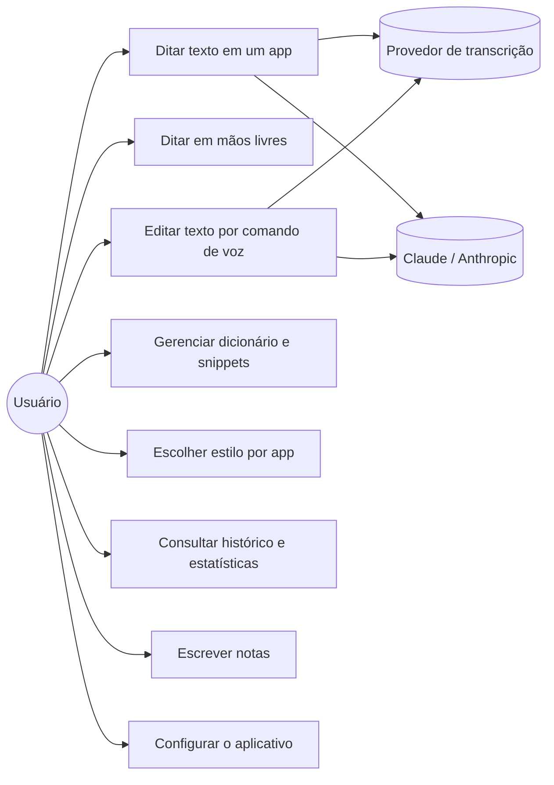
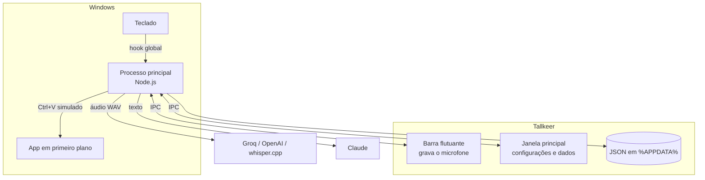

# Tallkeer: relatório técnico do projeto

> Disciplina: Engenharia de Software
> Autor: Gabriel Varandas Rodrigues de Souza
> Versão do software: 0.2.1 (outubro de 2026)

## Sumário

1. [Introdução](#1-introdução)
2. [Objetivo](#2-objetivo)
3. [Software de inspiração](#3-software-de-inspiração)
4. [Processo de desenvolvimento](#4-processo-de-desenvolvimento)
5. [Requisitos](#5-requisitos)
6. [Tecnologias e ferramentas](#6-tecnologias-e-ferramentas)
7. [Arquitetura](#7-arquitetura)
8. [Funcionalidades](#8-funcionalidades)
9. [Design da interface](#9-design-da-interface)
10. [Testes e qualidade](#10-testes-e-qualidade)
11. [Segurança e privacidade](#11-segurança-e-privacidade)
12. [Empacotamento e distribuição](#12-empacotamento-e-distribuição)
13. [Problemas encontrados e soluções](#13-problemas-encontrados-e-soluções)
14. [Limitações e trabalhos futuros](#14-limitações-e-trabalhos-futuros)
15. [Conclusão](#15-conclusão)

---

## 1. Introdução

O **Tallkeer** é um aplicativo de ditado por voz para Windows. O usuário segura um atalho de teclado, fala e solta; o aplicativo transcreve a fala, formata o texto com inteligência artificial e o insere onde estiver o cursor, em qualquer programa (WhatsApp, Word, Outlook, navegador, editores de código etc.).

Além do ditado, o Tallkeer edita textos por comando de voz, ajusta o tom da escrita conforme o aplicativo em uso, mantém um dicionário pessoal, atalhos de voz (snippets), histórico, estatísticas de uso e um bloco de notas.

## 2. Objetivo

A proposta do trabalho era desenvolver um software próprio ou inspirado em um software existente. O Tallkeer é **inspirado no Wispr Flow**, um aplicativo comercial de ditado por voz, e foi escrito **com código inteiramente próprio**, aplicando as etapas de engenharia de software: estudo do software de inspiração, levantamento de requisitos, projeto da arquitetura, implementação, testes, empacotamento, evolução (redesenho) e manutenção corretiva.

Objetivos específicos:

- Ditar texto em qualquer aplicativo do Windows com um atalho global.
- Produzir texto final limpo (pontuação, sem hesitações, com autocorreções).
- Permitir edição de texto por comando de voz.
- Funcionar com provedores de transcrição na nuvem ou totalmente offline.
- Guardar os dados do usuário apenas no computador dele.
- Oferecer uma interface elegante, minimalista e com tema claro/escuro.

## 3. Software de inspiração

O **Wispr Flow** é um aplicativo comercial de ditado por voz: o usuário segura uma tecla, fala, e o texto aparece já formatado no programa em uso. Ele serviu de **inspiração** para a ideia e para a lista de funcionalidades do Tallkeer.

> **Importante:** o Tallkeer não usa nenhum código, texto, imagem ou servidor do Wispr Flow. Toda a implementação é própria e usa componentes de código aberto e serviços públicos de terceiros (Groq, OpenAI, Anthropic).

### 3.1 Da ideia ao Tallkeer

| Comportamento observado no Wispr Flow | Como o Tallkeer resolve |
| --- | --- |
| Ditado ao segurar um atalho, em qualquer aplicativo | Hook global de teclado com `uiohook-napi` e máquina de estados própria (`hotkeys.js`) |
| Barra flutuante que mostra a gravação sem atrapalhar o app em uso | Janela Electron transparente e sem foco |
| Texto limpo, pontuado e no tom do aplicativo | Transcrição com Whisper (Groq/OpenAI ou whisper.cpp local) e formatação com o Claude |
| Dicionário, snippets, histórico e notas | Arquivos JSON locais em `%APPDATA%\Tallkeer` |
| Edição de um texto selecionado por voz | Modo Comando: copia a seleção, envia a instrução ao Claude e cola o resultado |

### 3.2 Funcionalidades incluídas e deixadas de fora

**Incluídas:** ditado por atalho, mãos livres, modo comando, formatação por IA, estilos por aplicativo, dicionário, snippets, histórico, estatísticas, notas, barra flutuante, bandeja do sistema.

**Deixadas de fora** (exigiriam servidores e infraestrutura própria): gravação e resumo de reuniões, integração com agenda, compartilhamento, sincronização entre dispositivos e contas de equipe.

## 4. Processo de desenvolvimento

O desenvolvimento seguiu o **modelo incremental**, com entregas funcionais a cada etapa e testes automatizados desde o início. A justificativa da escolha, as alternativas descartadas, os limites e o uso do Git estão na seção **[Metodologias Utilizadas do README](../README.md#3-metodologias-utilizadas)**.

### 4.1 Etapas

| # | Etapa | O que foi feito | Resultado |
| --- | --- | --- | --- |
| 1 | Estudo do software de inspiração | Levantamento das funcionalidades e do comportamento do Wispr Flow | Lista de funcionalidades (seção 3) |
| 2 | Requisitos | Funcionalidades priorizadas, requisitos não funcionais definidos | Seção 5 |
| 3 | Arquitetura | Processos, módulos, fluxo de dados, persistência, segurança | Seção 7 e [ARQUITETURA.md](ARQUITETURA.md) |
| 4 | Implementação do núcleo | Máquina de estados de atalhos, gravação de áudio, transcrição, formatação, colagem | Ditado funcionando de ponta a ponta |
| 5 | Funcionalidades de apoio | Dicionário, snippets, estilos, histórico, estatísticas, notas, configurações | Funções principais do app de inspiração cobertas |
| 6 | Testes | Testes unitários, de integração com servidores simulados e teste de fumaça no Electron | Seção 10 |
| 7 | Empacotamento | Instalador Windows (NSIS) com `electron-builder` | v0.1.0, nome provisório "Ditado" |
| 8 | Evolução | Renomeação para **Tallkeer** e redesenho completo da interface | v0.2.0 |
| 9 | Manutenção corretiva | Correção da colagem após mudança de API do Electron 44 | v0.2.1 |

### 4.2 Ferramentas de apoio ao desenvolvimento

- **Claude Code** (assistente de programação com IA da Anthropic): usado durante todo o projeto para escrever código, testes e documentação, sob direção e revisão do autor.
- **Node.js 24** e **npm**: execução, dependências e scripts.
- **Git** e **GitHub**: versionamento e entrega.

## 5. Requisitos

### 5.1 Requisitos funcionais

| ID | Requisito |
| --- | --- |
| RF01 | Gravar a voz enquanto o usuário segura um atalho global configurável (padrão **Ctrl + Win**). |
| RF02 | Iniciar gravação contínua (mãos livres) com um toque rápido no atalho e encerrá-la com outro toque ou pela barra flutuante. |
| RF03 | Cancelar a gravação com **Esc**. |
| RF04 | Transcrever o áudio por Groq, OpenAI ou whisper.cpp local, à escolha do usuário. |
| RF05 | Formatar a transcrição com IA: pontuação, remoção de hesitações, autocorreções, listas e comandos falados. |
| RF06 | Inserir o texto no aplicativo em primeiro plano preservando a área de transferência do usuário. |
| RF07 | Editar o texto selecionado por instrução de voz (Modo Comando, **Ctrl + Win + Alt**). |
| RF08 | Aplicar estilo de escrita (formal, casual, muito casual) conforme a categoria do aplicativo. |
| RF09 | Manter dicionário pessoal com grafias corretas e variações a corrigir. |
| RF10 | Expandir snippets (frase-gatilho falada → texto cadastrado). |
| RF11 | Registrar histórico pesquisável com transcrição original e texto final. |
| RF12 | Exibir estatísticas: palavras, velocidade, tempo economizado, sequência de dias, app mais usado, gráfico semanal. |
| RF13 | Oferecer bloco de notas com salvamento automático. |
| RF14 | Permitir configurar atalhos, microfone, idioma, provedores, chaves de API, tema, sons e início com o Windows. |
| RF15 | Funcionar a partir da bandeja do sistema, com opções de abrir, copiar a última transcrição, pausar e sair. |

### 5.2 Requisitos não funcionais

| ID | Requisito | Como foi atendido |
| --- | --- | --- |
| RNF01 | **Privacidade:** dados do usuário somente no computador local | Arquivos JSON em `%APPDATA%\Tallkeer`; nenhum servidor próprio |
| RNF02 | **Segurança:** chaves de API protegidas | Criptografia DPAPI via `safeStorage`; janelas isoladas (`contextIsolation`, `sandbox`, CSP) |
| RNF03 | **Desempenho:** texto inserido em poucos segundos | Áudio PCM 16 kHz enviado direto; modelo Whisper Turbo; esforço baixo na IA de formatação |
| RNF04 | **Não intrusivo:** não roubar o foco do app em uso | Barra flutuante sem foco (`focusable: false`) e transparente a cliques |
| RNF05 | **Robustez:** nunca perder o ditado | Se a IA falhar, o texto entra com limpeza local; se a colagem falhar, fica na área de transferência |
| RNF06 | **Usabilidade:** interface clara em português | Navegação em 7 seções, primeiros passos guiados, mensagens de erro descritivas |
| RNF07 | **Acessibilidade:** respeito a preferências do sistema | Tema do sistema, redução de movimento, foco visível no teclado |
| RNF08 | **Portabilidade de provedor:** não depender de um único serviço | Três provedores de transcrição, um deles offline |
| RNF09 | **Manutenibilidade:** código modular e testado | 14 módulos no processo principal, 37 testes automatizados |

### 5.3 Casos de uso

**UC1, Ditar texto em um aplicativo (fluxo principal):**
1. O usuário posiciona o cursor em um campo de texto de qualquer aplicativo.
2. Segura **Ctrl + Win**; a barra flutuante aparece e um som indica o início.
3. Fala; a barra mostra a onda sonora e o tempo.
4. Solta as teclas; a barra mostra "Transcrevendo".
5. O sistema transcreve, formata, aplica dicionário e snippets e cola o texto.
6. A barra mostra "Inserido" e desaparece; o ditado entra no histórico.

*Fluxos alternativos:* sem fala detectada ("Não ouvi nada"); chave ausente ou inválida (mensagem na barra); falha da IA (texto inserido sem formatação, com aviso); outro atalho do Windows iniciado com Ctrl + Win (gravação cancelada).

## 6. Tecnologias e ferramentas

| Tecnologia | Versão | Uso no projeto | Por que foi escolhida |
| --- | --- | --- | --- |
| **Electron** | 44.9.2 | Aplicativo desktop (Chromium + Node.js) | Interface em HTML/CSS/JS com acesso ao sistema operacional, numa única linguagem |
| **JavaScript (Node.js)** | Node 24 | Toda a lógica | Uma linguagem para interface e sistema; sem etapa de compilação |
| **HTML5 + CSS3** | — | Interface | Controle total do design, variáveis CSS para temas |
| **Web Audio API / AudioWorklet** | — | Captura do microfone em PCM 16 kHz | Formato ideal para o Whisper, sem dependências |
| **uiohook-napi** | 1.5.5 | Hook global de teclado e teclas simuladas (Ctrl+V / Ctrl+C) | Detecta pressionar **e soltar** teclas, o que o atalho global nativo do Electron não faz |
| **koffi** | 3.3.3 | Chamadas diretas à API do Windows (`user32`, `kernel32`) | Descobrir o app em primeiro plano em menos de 1 ms, sem compilar código nativo |
| **@anthropic-ai/sdk** | 0.137.0 | Cliente oficial da API do Claude | Formatação e Modo Comando |
| **Groq API** (Whisper Large v3 Turbo) | — | Transcrição padrão | Rápida, com plano gratuito |
| **OpenAI API** (gpt-4o-mini-transcribe) | — | Transcrição alternativa | Opção para quem já tem conta |
| **whisper.cpp** | — | Transcrição offline opcional | Gratuita e sem internet |
| **Claude** (Opus 5.5, Sonnet 5.5, Haiku 5.5) | — | Modelo de linguagem para formatar e editar | Qualidade de escrita em português; fallback automático em recusas |
| **electron-builder** | 26.15.3 | Gera o instalador `.exe` (NSIS) | Padrão do ecossistema Electron |
| **node:test** | nativo | Testes automatizados | Sem dependências extras |
| **Instrument Serif, Geist, Geist Mono** | — | Tipografia (licença SIL OFL) | Visual editorial; embutidas para funcionar offline |
| **Claude Code** | — | Assistente de programação com IA | Apoio à análise, implementação, testes e documentação |

## 7. Arquitetura

A arquitetura completa, com diagramas, está em **[ARQUITETURA.md](ARQUITETURA.md)**. Resumo:

- **Processo principal:** atalhos, fluxo do ditado (pipeline), transcrição, formatação, colagem, persistência, bandeja.
- **Barra flutuante:** grava o microfone, desenha a onda sonora, mostra o estado. Não recebe foco.
- **Janela principal:** início, histórico, dicionário, snippets, estilos, notas e configurações.
- **Comunicação:** IPC do Electron com pontes `preload` mínimas; cada canal verifica qual janela enviou a mensagem.

## 8. Funcionalidades

A descrição detalhada de cada funcionalidade está em **[FUNCIONALIDADES.md](FUNCIONALIDADES.md)**. Visão geral:

| Grupo | Funcionalidades |
| --- | --- |
| Falar e escrever | Ditado por atalho, mãos livres, Modo Comando, cancelamento |
| Inteligência do texto | Formatação por IA, estilos por app, regras por app, dicionário, snippets, filtro de alucinações |
| Transcrição | Groq, OpenAI ou whisper.cpp; idioma automático ou fixo; escolha de microfone |
| Organização | Histórico pesquisável, estatísticas com gráfico, notas |
| Conforto | Barra flutuante, sons, tema claro/escuro, atalhos personalizáveis, bandeja, início com o Windows |
| Privacidade | Dados locais, chaves criptografadas, opções de envio de contexto, área de transferência preservada |

## 9. Design da interface

A interface foi redesenhada na versão 0.2.0 com a proposta **minimalista editorial**: monocromático quente, tipografia de alto contraste e movimento discreto.

| Elemento | Decisão |
| --- | --- |
| Tipografia | **Instrument Serif** em títulos e números grandes (com uma palavra em itálico, ex.: "Seu *histórico*"); **Geist** na interface; **Geist Mono** em atalhos e horários |
| Paleta clara | Fundo osso `#F6F5F1`, superfícies `#FBFAF7`, texto grafite `#1B1A17`, linhas `#E6E3DB` |
| Paleta escura | Fundo `#121211`, superfícies `#171715`, texto `#ECEBE6`, linhas `#262522` |
| Cor | Usada apenas para estado: verde-sálvia (pronto), terracota (gravando/erro), areia (pendente) |
| Componentes | Bordas de 1 px, cantos de 8 a 12 px, sem sombras pesadas, botão primário grafite |
| Movimento | Entrada escalonada dos blocos, indicador deslizante na navegação, números que sobem até o valor, barras do gráfico que crescem; curva `cubic-bezier(0.16, 1, 0.3, 1)` |
| Barra flutuante | Cápsula grafite com onda sonora simétrica que nasce no centro, ponto pulsante e cronômetro |
| Acessibilidade | Respeita "reduzir movimento" do Windows, foco visível, rótulos ARIA |

| Tema claro | Tema escuro |
| --- | --- |
|  |  |

## 10. Testes e qualidade

A estratégia combina três níveis, todos automatizados:

| Nível | Ferramenta | O que cobre |
| --- | --- | --- |
| **Unitário** | `node:test` | Máquina de estados dos atalhos, limpeza de texto, dicionário, snippets, estatísticas, persistência |
| **Integração simulada** | Servidor HTTP local e `fetch` substituído | Formato exato das requisições à Anthropic (modelo, cabeçalho beta de fallback, esforço, contexto) e à Groq/OpenAI (áudio, idioma, vocabulário); tratamento de erros 401/429/recusa |
| **Fumaça (end-to-end)** | `electron . --smoke=<pasta>` | Abre o app real com dados de exemplo, fotografa as 7 telas nos 2 temas e os 4 estados da barra, e executa um ditado completo com o **microfone simulado do Chromium** |

**Resultado atual:** 37 testes, 37 aprovados; teste de fumaça sem erros no código-fonte e no aplicativo empacotado.

| Arquivo de teste | Testes | Foco |
| --- | ---: | --- |
| `hotkeys.test.js` | 11 | Segurar, toque rápido, modo comando, Esc, teclas presas, conflito com atalhos do Windows |
| `textops.test.js` | 10 | Hesitações, alucinações do Whisper, dicionário, snippets, contagem de palavras |
| `store.test.js` | 6 | Configurações, criptografia de chaves, histórico, coleções |
| `formatter.test.js` | 4 | Requisições ao Claude e mensagens de erro |
| `stats.test.js` | 3 | Velocidade, tempo economizado, sequência, gráfico semanal |
| `transcribe.test.js` | 3 | Groq, OpenAI, erros |

## 11. Segurança e privacidade

- **Isolamento das janelas:** `contextIsolation`, `sandbox` e Content Security Policy restritiva; o código da interface não acessa Node.js.
- **IPC validado:** cada canal confere se a mensagem veio da janela esperada.
- **Sem HTML injetado:** a interface cria elementos com `textContent`, nunca com `innerHTML`, evitando XSS com textos ditados.
- **Chaves de API** criptografadas com DPAPI; a interface nunca recebe a chave, apenas se ela existe.
- **Permissões mínimas:** só o microfone (áudio) é liberado; links externos só para uma lista fixa de páginas.
- **Prompt injection:** o texto ditado é tratado como conteúdo a formatar, nunca como instrução para a IA.
- **Dados:** áudio enviado apenas ao provedor escolhido; histórico, dicionário, snippets e notas só no computador.

## 12. Empacotamento e distribuição

- `npm run dist` gera o ícone (desenhado em código) e o instalador `Tallkeer Setup <versão>.exe` com o `electron-builder` (NSIS, instalação por usuário, sem pedir administrador).
- Os módulos nativos (`uiohook-napi`, `koffi`) usam N-API com binários pré-compilados, então não precisam ser recompilados para o Electron.
- O instalador mantém o identificador interno da primeira versão para **atualizar por cima**, sem duplicar a instalação.
- O executável não tem assinatura digital paga; o Windows exibe um aviso na primeira execução.

## 13. Problemas encontrados e soluções

| Problema | Causa | Solução |
| --- | --- | --- |
| O Electron não abria na pasta temporária inicial | Caminho com mais de 260 caracteres (limite do Windows) | Projeto movido para uma pasta com caminho curto |
| O empacotador tentava recompilar o hook de teclado | Ausência do Visual Studio na máquina | `npmRebuild: false`, já que os módulos N-API são pré-compilados |
| O Whisper "inventa" frases no silêncio ("Obrigado.", "Legendas pela comunidade Amara.org") | Comportamento conhecido do modelo | Detecção de fala no áudio e filtro de frases conhecidas |
| Colar com Ctrl+V enquanto o usuário ainda segura Win abriria o histórico de área de transferência (Win+V) | Teclas modificadoras ainda pressionadas | Espera todas as modificadoras serem soltas antes de colar |
| Teclas "presas" após Win+L ou tela do UAC | O sistema não entrega o evento de soltar | Verificação do estado real via `GetAsyncKeyState` |
| **v0.2.1:** erro `clipboard.availableFormats is not a function` | O Electron 44 trocou a API de área de transferência por uma versão assíncrona | Módulo de colagem reescrito com `clipboard.read/write` e `ClipboardItem`; teste de fumaça passou a cobrir esse trecho |

## 14. Limitações e trabalhos futuros

**Limitações**
- Funciona apenas no Windows 10/11.
- Depende de chaves de API pagas ou com cota para transcrever na nuvem (exceto com whisper.cpp).
- Não lê o conteúdo do campo de texto em foco (exigiria a UI Automation do Windows).
- Instalador sem assinatura digital.
- Dados não sincronizam entre computadores.

**Trabalhos futuros**
- Leitura do contexto do campo de texto por UI Automation.
- Transcrição em tempo real (streaming) enquanto o usuário fala.
- Sincronização opcional e criptografada entre dispositivos.
- Versão para macOS.
- Atualização automática do aplicativo.
- Assinatura digital do instalador.

## 15. Conclusão

O Tallkeer, inspirado em um software comercial de ditado por voz, entrega as funcionalidades centrais desse tipo de aplicativo com código próprio, seguindo um processo de engenharia de software completo: estudo do software de inspiração, requisitos, arquitetura modular, implementação incremental, testes automatizados em três níveis, empacotamento, evolução da interface e manutenção corretiva.

O projeto também mostrou na prática temas da disciplina: o valor de testes que exercitam o sistema real (o bug da v0.2.1 escapou justamente de um trecho que o teste simulava), o impacto de mudanças em dependências externas e a importância de requisitos não funcionais como privacidade, segurança e robustez.
